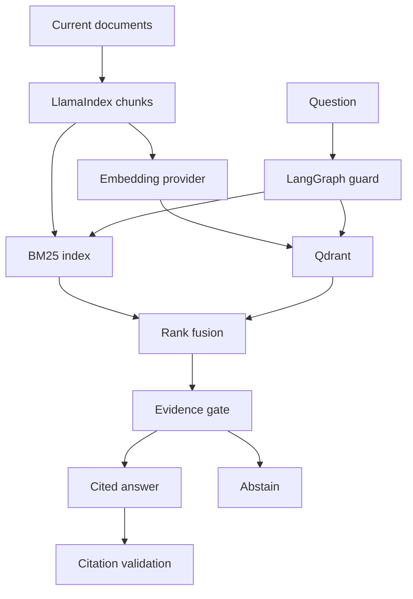

# SourceDesk — RAG Customer Support Lab

An interview-ready, inspectable support demo: ask a question, inspect retrieval scores, open citations, compare search methods, and run evaluations. All company documents and policies are fictional.

The hosted demo is currently owner-private. Anyone can run this public source locally using the instructions below.

## What actually runs

| Mode | Orchestration | Retrieval / storage | Answering |
|---|---|---|---|
| Hosted browser | JavaScript pipeline | BM25 + concept-expanded vectors, in-memory index, RRF | Verbatim cited passages; no LLM |
| Python offline | **LangGraph** | **LlamaIndex** chunking, BM25 + hashed vectors, **Qdrant** embedded store, RRF | Verbatim cited passages |
| Python live | **LangGraph** | **LlamaIndex**, BM25 + **OpenAI embeddings**, **Qdrant**, RRF | **OpenAI** generation with citation-ID validation |

The browser implementation is deliberately key-free. Its concept vectors are not trained embeddings. Python offline vectors are deterministic feature hashes. The live mode uses real API calls and incurs usage charges; it does not silently downgrade to offline mode. The embedded Qdrant collection is rebuilt at process startup and is not a hosted durable database.

## Run the full Python + UI demo

Python 3.12+ and Node 18+ are recommended. Tested here with Python 3.12.

```bash
python -m venv .venv
source .venv/bin/activate
pip install -r requirements.txt
uvicorn backend.app:app --host 127.0.0.1 --port 8000
```

Open **http://127.0.0.1:8000/?engine=python**. This sends playground questions to the actual LangGraph service. Without the query parameter the same UI runs the independent browser engine. The evaluation tab always measures the browser engine; use the Python test script and judge adapters to evaluate the backend.

Windows activation: `.venv\Scripts\activate`.

### Real model mode

Set environment variables on the server before starting it:

```bash
export RAG_MODE=live
export OPENAI_API_KEY='your-own-key'
export CHAT_MODEL=gpt-4.1-mini
export EMBED_MODEL=text-embedding-3-small
uvicorn backend.app:app --host 127.0.0.1 --port 8000
```

Never place the key in frontend code or commit it. `.env.example` documents the settings; `.env` files are not loaded automatically. Use a model available to your account. Live generation, embeddings and paid judge calls were not executed during this build because no API key was supplied.

### Browser only

```bash
python -m http.server 8000 --directory dist
```

Open http://127.0.0.1:8000. No dependencies or API key needed.

## Five-minute demo script

1. **Grounded answer:** ask “Can I get a refund for my annual subscription?” Open the citation. Show the 14-day current policy and the archived 30-day policy excluded from search.
2. **Explain retrieval:** open Pipeline trace, then compare Hybrid, Keyword only and Vector only. Raw scores are visible; they are not probabilities.
3. **Troubleshooting:** ask “How do I fix SSO_403 sign-in error?” Show the exact error-code match, source version and actionable steps.
4. **Responsible abstention:** ask “What is the CEO home address?” The agent declines to invent an answer. No support ticket is actually created.
5. **Evaluate:** run the 13-case suite. Discuss hit rate@3, top-1 accuracy, citation membership, abstention and why a small synthetic suite is insufficient for production.

The “Run showcase” button steps through grounded billing, SSO, rate limits, unknown questions and an instruction-injection example. It runs the actual engine each time.

## Verify

```bash
node tests/retrieval.mjs
python tests/backend_smoke.py
```

The browser suite has 13 cases and checks archived-policy exclusion and source-text integrity. The backend smoke test invokes real LangGraph nodes, LlamaIndex chunking, BM25 and embedded Qdrant through FastAPI's test client. It covers six supported topics, abstention, a basic instruction-pattern block, input validation and UI serving.

### RAGAS / DeepEval

These are optional model-judged adapters, not fabricated dashboard metrics:

```bash
pip install -r requirements-eval.txt
export OPENAI_API_KEY='your-own-key'
python backend/evaluate_judges.py --framework ragas
python backend/evaluate_judges.py --framework deepeval
```

Set `RAG_MODE=live` to evaluate generated responses; otherwise the judges evaluate the Python offline extractive answers. Results are saved to local JSON. Adapters have been syntax-checked but their optional dependency sets and paid model calls have not been execution-tested. Review compatibility in your environment before use. Judge scores are probabilistic and do not replace human review.

## Architecture



The offline and browser pipelines are stateless question answering. They do not claim conversational memory, autonomous account mutations, production-grade prompt-injection defense, or real support-ticket creation. A new question is independent of previous chat bubbles.

## Scope and limitations

- Corpus: 13 current documents and 1 archived document. New documents require updating `dist/corpus.json`; the next browser reload or backend restart rebuilds the index.
- The evidence gate is a simple overlap/similarity heuristic. Lexical overlap is not proof of answerability. It can fail on paraphrases, unsupported details and negation; evaluate these before production use.
- Regex prompt checks demonstrate a guard stage; they are not a comprehensive security system.
- Citation validation checks that IDs are present and allowed. It does not establish semantic faithfulness of generated claims.
- The backend is a localhost, single-user demo. Do not expose it directly: add authentication, tenant-aware retrieval filters, request limits, durable storage, secrets management and monitoring first.
- UI is responsive with semantic controls, labels and keyboard submission. Full browser visual QA and browser WebMCP validation were unavailable in the build environment.
- The optional WebMCP tools are feature-detected. `ask_support_question` and `run_support_evaluation` reuse visible app actions.

## References

- LangGraph: https://reference.langchain.com/python/langgraph/graph/state/StateGraph
- LlamaIndex: https://developers.llamaindex.ai/python/framework/module_guides/supporting_modules/settings/
- Qdrant query API: https://api.qdrant.tech/api-reference/search/query-points/
- RAGAS evaluation: https://docs.ragas.io/en/v0.3.2/references/evaluate/
- DeepEval faithfulness: https://deepeval.com/docs/metrics-faithfulness

## Project map

- `dist/`: deployable UI, browser retrieval engine, versioned fictional corpus
- `backend/app.py`: Python graph, vector store, API, local UI hosting
- `backend/evaluate_judges.py`: optional RAGAS and DeepEval adapters
- `tests/`: executable retrieval and backend checks
- `requirements.txt`: exact tested primary dependency versions
- `requirements-lock.txt`: complete tested Python environment

Built for Jagprit Batra's engineering portfolio.
